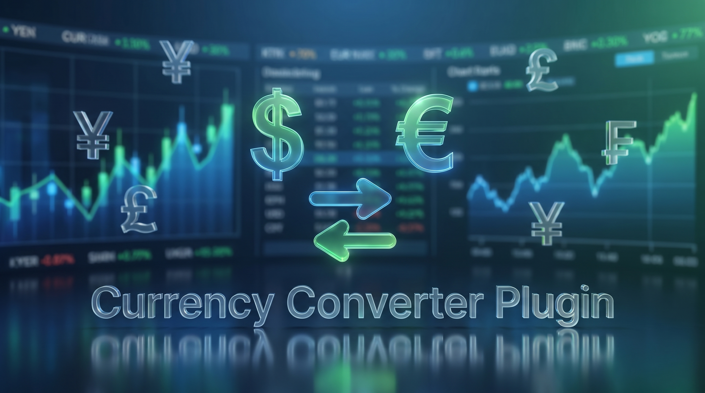
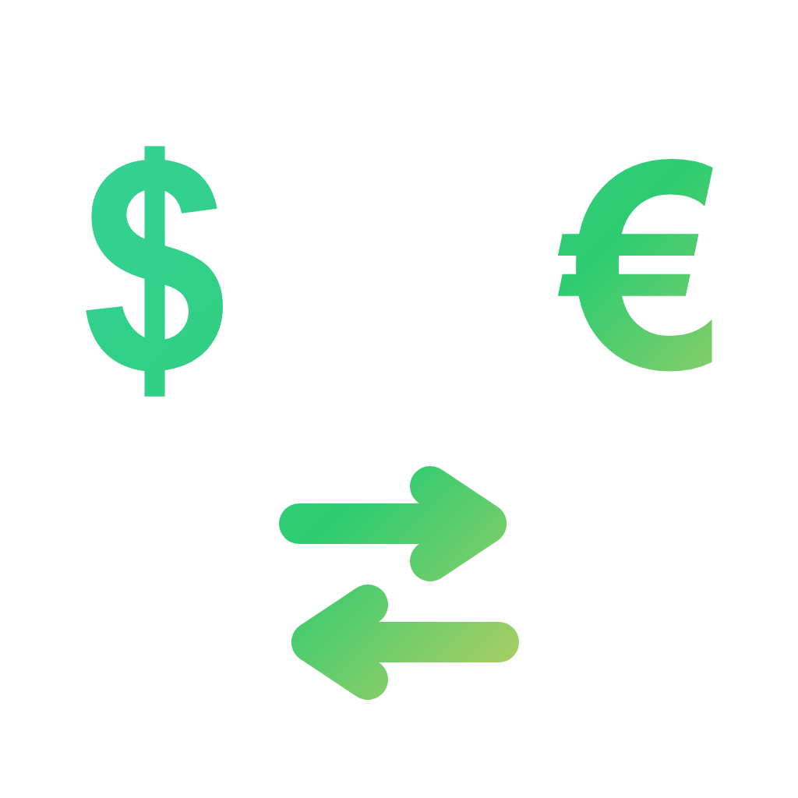

<div align="center">
<p align="center">
  
  
</p>

**Live currency conversion on your Ulanzi Deck — 166 currencies, one key.**

Pick two currencies, set an amount, and the key shows the converted value with the live rate, a trend arrow and a mini chart. Press the key to invert the conversion.


</div>

---

## ✨ Three screen styles

One action, one key. The value is shown **big and centered**, with the live rate and trend. Pick the layout that fits your deck.

| Style | What it shows | Layout |
|-------|---------------|--------|
|  **Classic** | Header, big value, rate line, change % | pair → value → `1 USD = 5.18 BRL` → ▲ % |
|  **Chart** | Currency pair, sparkline, value + change | pair → mini chart → value + ▲ % |
|  **Minimal** | Pair on top, large value, target code | pair → big value → target code |

---

## 🎨 Features

- **Press-to-invert** — tap the key to swap From ↔ To instantly (e.g. `USD → BRL` becomes `BRL → USD`); the new pair is saved.
- **166 currencies** — live rates via a free public API (no key, no account).
- **Live value + trend** — converted amount, exchange rate, ▲/▼ direction and % change vs. the previous reading.
- **Marquee** — long values and headers (billions, big amounts) scroll automatically instead of clipping.
- **No-tofu symbols** — when the font lacks a currency glyph (₮ ₭ ฿ ₡ ₴ …) the key falls back to the ISO code, never a broken box.
- **8 color themes** (Emerald, Midnight, Gold, Ocean, Grape, Mono, Paper, Sand), **4 vector fonts**, optional animated accent.
- **Auto-refresh** on a configurable interval (no key press needed) + a **Refresh now** button.
- **Built-in tutorial** — a **?** button on the action opens a step-by-step guide, localized.
- **11 languages** — English, Português (BR/PT), Español, Français, Deutsch, Italiano, 日本語, 한국어, 中文 (简/繁) — including currency names translated per locale.
- **Cross-platform & light** — pure-JS (no native binaries); glyph caching, shared rate cache and frame dedup keep the deck idle when nothing changes.

---

## ⚙️ Settings

| Setting | Description |
|---------|-------------|
| **From / To** | Source and target currency (searchable, flag + ISO code + name). |
| **Amount** | Value to convert (defaults to 1). |
| **Decimals** | Fixed decimal places, or auto when blank. |
| **Interval** | Auto-refresh period in minutes (min 1). |
| **Refresh now** | Forces an immediate update. |
| **Screen** | Classic · Chart · Minimal. |
| **Theme / Font** | Color palette and typeface. |

The footer shows the **last local check time** (`upd HH:MM`) and a pulsing **"updating…"** cue while fetching.

---

## 🚀 Built for many keys

Designed so you can fill the deck without weighing on the CPU:

- **Shared rate cache** — every key on the same base currency shares **one** network fetch (reused 60s, concurrent requests coalesced). 20 keys cost the same as 1.
- **Single animation ticker** — one 5 fps timer drives every key that needs motion; a still key has **no timer at all** (zero idle CPU).
- **Glyph / width caching** + **redundant-send dedup** — marquee frames are nearly free and identical frames are never re-pushed to the deck.

> The free API refreshes rates roughly once a day, so the converted value can stay the same between checks — the footer time still updates to confirm the key polled.

---

## 📦 Installation

**From the Ulanzi store:** search for **Currency Converter** and install.

**Manual:**
1. Download/clone this repository.
2. Copy the `com.currency.converter.ulanziPlugin` folder into your Ulanzi plugins directory:
   - **Windows:** `%AppData%\Ulanzi\UlanziDeck\Plugins\`
   - **macOS:** `~/Library/Application Support/Ulanzi/UlanziDeck/Plugins/`
3. Restart UlanziDeck Studio.

---

## 🗂️ Repository structure

```
com.currency.converter.ulanziPlugin/
├── manifest.json            # 1 action (Keypad)
├── plugin/app.js            # backend: fetch + render + cache
├── property-inspector/
│   ├── inspector.html/js    # settings panel + live preview
│   └── tutorial.html        # step-by-step guide (11 langs)
├── assets/icons/            # action + brand icons
├── assets/marketing/        # banner + store art
├── <lang>.json × 11         # localization
├── LICENSE · THIRD-PARTY-LICENSES.md
└── node_modules/ (opentype.js, ws)
```

---

## 🛠️ Tech

- **Data:** [open.er-api.com](https://open.er-api.com) (free, no key). **Currency names:** native `Intl.DisplayNames` per locale. **Text:** vector glyphs via `opentype.js`.
- **No telemetry**, no accounts — the only request is the public exchange-rate endpoint over HTTPS.
- Performance: shared rate fetches, one shared animation timer, glyph caching and identical-frame dedup.

---

## 📄 License

MIT © Jean Almeida — see [`LICENSE`](com.currency.converter.ulanziPlugin/LICENSE).
Third-party notices in [`THIRD-PARTY-LICENSES.md`](com.currency.converter.ulanziPlugin/THIRD-PARTY-LICENSES.md).
